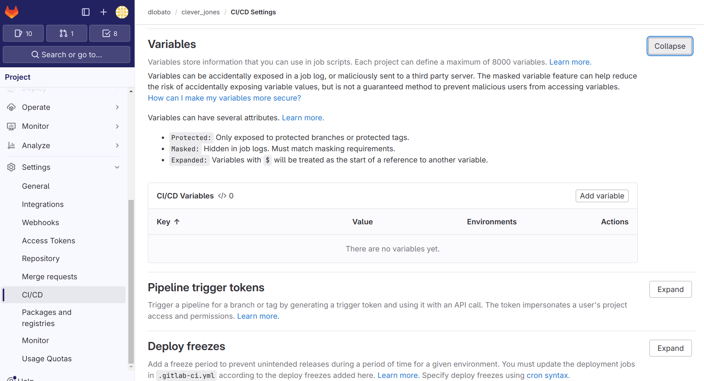
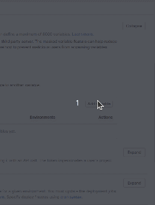

# clever_jones

## Quick start

This is a brief summary of instruction required to set up your CI/CD environment. Please refer to the deployment guide for more
details.

To set up the CI/CD environment to deploy to your infrastructure you need to configure some CI/CD variables. File type variables
are marked as `file type` between parenthesis. Pay attention when doing copy&paste on variable values to avoid introducing extra
new lines or other characters (specially important for SSH_PRIVATE_KEY).

- CLAB_HOSTS (file type): A csv file with the format. This is a list of all the clab hosts in
  your cluster with format: `host-name, host-ip`.

    ```csv
    lab1,10.18.153.26
    lab2,10.18.153.24
    lab3,10.18.153.23
    lab4,10.18.147.185
    lab5,10.18.148.60
    ...
    ```

- CLAB_KNOWN_HOSTS (optional, file type): An ssh known_hosts file with the infra hosts signatures.
  If not provided, use `SSH_CONFIG` to disable strict host key checks.

    ```known_hosts
    lab1,10.18.153.26 ssh-ed25519 AAAAC3NzaC1lZDI1NTE5AAAAIEFQpSMrToqZgZPqeaJT4us5oU3w8keq/Ms7zhsnKr69
    lab2,10.18.153.24 ssh-ed25519 AAAAC3NzaC1lZDI1NTE5AAAAIHhhOsAitSlJr7ph+KjnPIGhMYgaAqXGhNwf96jdy1rT
    lab3,10.18.153.23 ssh-ed25519 AAAAC3NzaC1lZDI1NTE5AAAAIH+PEH2hMeI7KSeIzcW7EjpJZTOh/QteICbslCQzJoc8
    lab4,10.18.147.185 ssh-ed25519 AAAAC3NzaC1lZDI1NTE5AAAAIHpLIlLz5XQ2dVZgLKiB+HqBsa1hJCdbCVnUYKjznSmU
    lab5,10.18.148.60 ssh-ed25519 AAAAC3NzaC1lZDI1NTE5AAAAIE18IoQPb9f6cs6K6qt+YkSlAWOk5DJNX11IJxP2Opbv
    ...
    ```

- SSH_CONFIG (optional, file type): Ssh configuration used by the runner ssh client to execute remote commands on clab hosts.
  An example SSH_CONFIG to disable strict host key checking looks like (see man ssh_config for more options):

  ```ssh
  Host *
    StrictHostKeyChecking no
    UserKnownHostsFile=/dev/null
  ```

- SSH_USER (default=`arista`): The ssh user used to interact with the clab hosts while deploying the digital twin.
  The user must have admin rights in order to execute clab deploy.

- SSH_PRIVATE_KEY (file type, masked): The ssh private key (encoded with base64 because of gitlab requirements for masked
  variables) configured for the `SSH_USER` user. To generate the base64 string use the following command:

  ````shell
  $> base64 -w0 < private_key_path
  ````

- RUNTIME_ENV_IMAGE_TAG: Version tag of the intended `runtime-env` image to use in the pipeline.
- ANTA_USERNAME: Used by [anta nrfu](https://anta.arista.com/stable/cli/nrfu/) to connect to EOS
- ANTA_PASSWORD: Used by [anta nrfu](https://anta.arista.com/stable/cli/nrfu/) to connect to EOS
- CV_DEPLOY_SERVER (optional): hostname or IP address of CloudVision host used to cv_deploy (
  see [cv_deploy CloudVision server configuration](https://avd.arista.com/5.2/ansible_collections/arista/avd/roles/cv_deploy/index.html#cloudvision-server-configuration)).
  If this variable is not provided, the first entry from TELEMETRY_PRODUCTION_SERVERS will be used.
- CV_DEPLOY_TOKEN: service account token as defined on CloudVision
- TELEMETRY_PRODUCTION_SERVERS: CV production endpoints to stream telemetry
- NRFU_N_RUNNERS (optional, default=8): Number of runners to split NRFU over
- TOPOLOGY_SPLIT_STRATEGY (optional, default=disjoint): Strategy to split the topology.
    - disjoint: splits the topology into groups of nodes that don't have direct links. If there is not enough CLAB_HOSTS to
      accommodate the groups the split will fail
    - spread: slits the topology evenly between the provided CLAB_HOSTS
- CLAB_ENV (optional, file type): Defines the environment variables used when deploying a clab topology. If your base topology
  defined in `tools_config.yml` contains variables, for instance the image names, this variables should be
  defined in this file.

To add a file type variable go to Settings->CI/CD->Variables



Then add the required variables



## Runtime environment

The runtime-env image contains all the required software to process AVD configurations, deploy the digital twin, perform NRFU and
deploy configurations to CVP.

It is hosted in the project image registry. This image is a project deliverable and will be provided with each new version. The
current version should be set in the environment variable `RUNTIME_ENV_IMAGE_TAG` either by exporting it before running the import
commands or through the `.env` file.

### Push images to gitlab docker registry

1. Create a deployment token (
   see [other options to authenticate](https://docs.gitlab.com/ee/user/packages/container_registry/authenticate_with_container_registry.html))
2. Set your credentials in a `.env` file at project root (see `.env.dist`)
3. Load the image into your local docker registry with `RUNTIME_ENV_IMAGE_TAG=v0.0.3-dev1 make load-and-tag-runtime-env-image`
4. Push image to registry with `make push-runtime-env-image`
